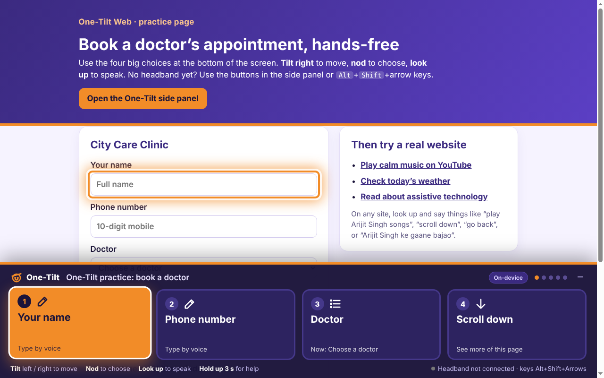
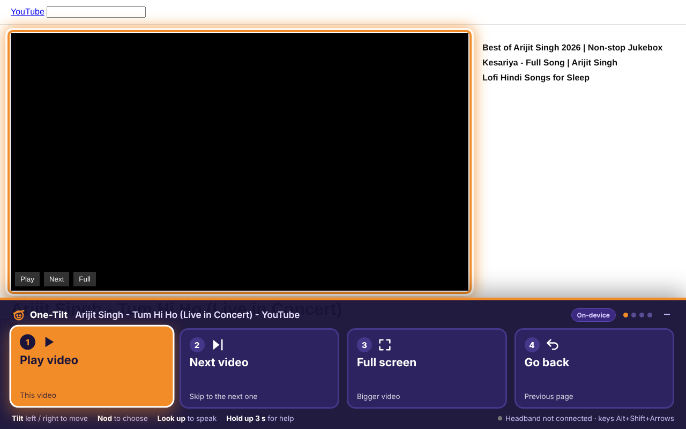
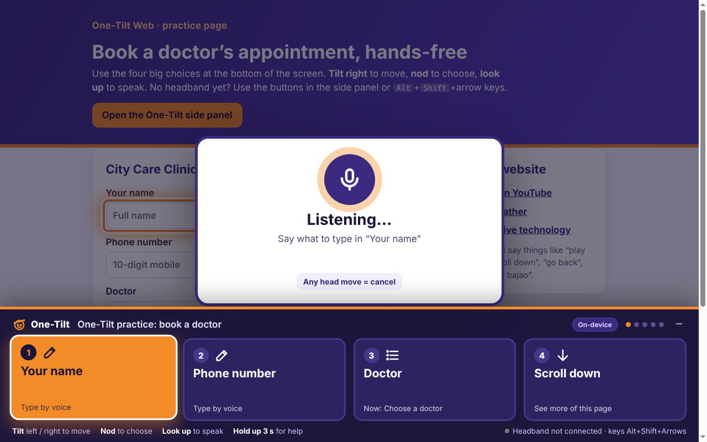
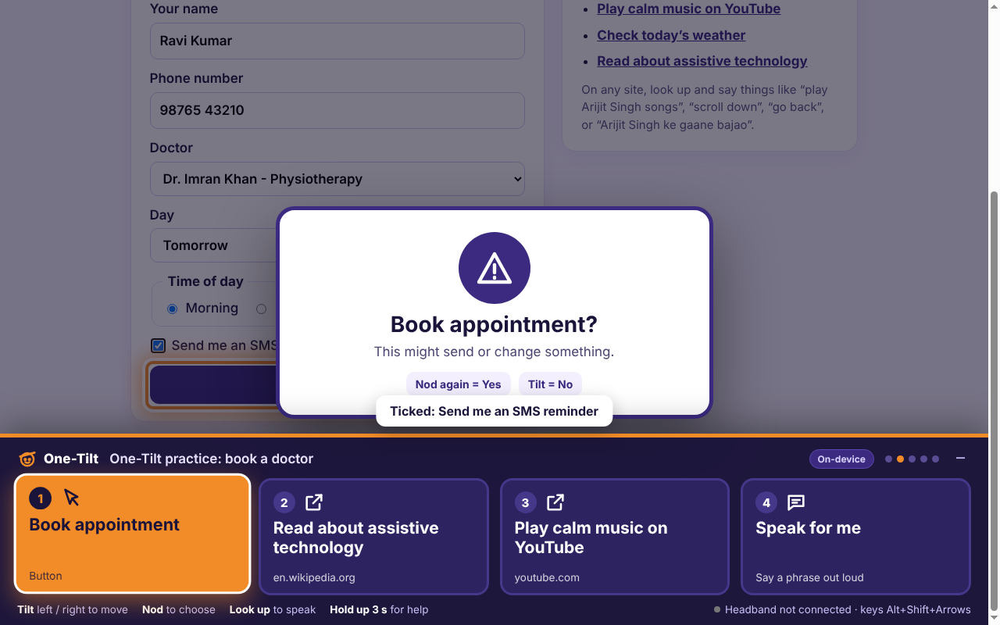
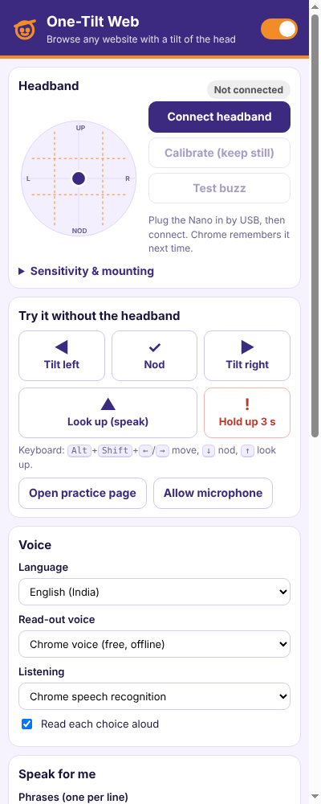
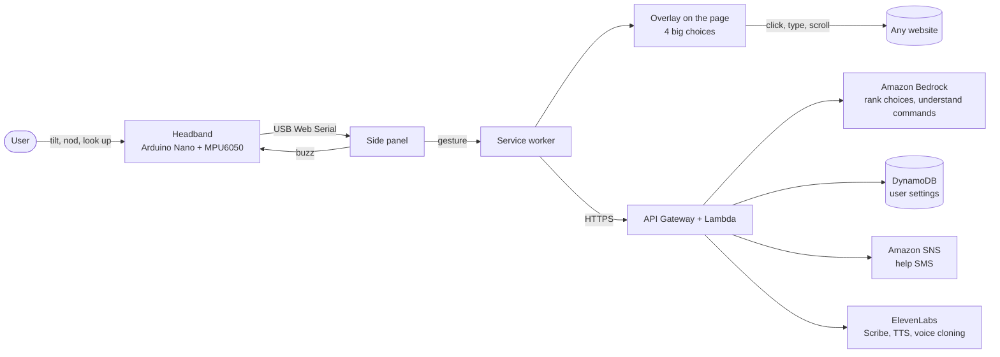

# One-Tilt Web

**Browse any website with a tilt of your head. No hands, no mouse, no keyboard.**

wHACKiest 2026 · Track 2 (T-2): Beyond the Browser
Team Byte By Byte · Dayananda Sagar Academy of Technology and Management, Bengaluru
Deepankar Anand (Lead) · Juwariyah Anam



A ₹600 sensor headband and a Chrome extension that turn **any website into four big choices**. The user tilts their head to move between them, nods to choose, looks up to speak a command, and keeps looking up for 3 seconds to call for help.

## Status: working MVP

| Part | What works now | Proof |
| --- | --- | --- |
| **Headband firmware** (Arduino Nano + MPU6050) | Tilt / nod / look-up / help detection, calibration, drift correction, haptic buzz, backup button, settings saved in EEPROM | 18 gesture-engine tests |
| **Chrome extension** | Four-choice overlay on any site, smarter choices on YouTube and Google, forms filled by voice, dropdowns as big choices, confirm before submit, voice commands in English and Hindi, "Speak for me", help alert, read page aloud | 33 end-to-end checks in real Chrome |
| **Side panel** | USB headband connection (Web Serial), live head-position view, calibration and sensitivity, gesture simulator, all settings | Screenshot below |
| **AWS backend** | API Gateway + Lambda (SAM template), Amazon Bedrock ranks choices and understands commands, DynamoDB settings, SNS help texts, ElevenLabs speech, Scribe and voice cloning | 13 handler tests (AWS and ElevenLabs mocked) |

Everything works **on-device with no API keys**. The AWS backend makes the choices smarter and adds natural voices and SMS alerts. Next: build the electronics into the band and connect our live AWS and ElevenLabs accounts.

## Try it in 2 minutes (no headband needed)

1. Download this repo (**Code → Download ZIP**) and unzip it.
2. In Chrome, open `chrome://extensions`, switch on **Developer mode**, click **Load unpacked** and pick the `extension` folder.
3. A practice page opens. Click the One-Tilt icon in the toolbar (pin it from the puzzle-piece menu) to open the side panel.
4. Move with the **Try it without the headband** buttons, or the keyboard:
   `Alt+Shift+→` next · `Alt+Shift+←` previous · `Alt+Shift+↓` nod (choose) · `Alt+Shift+↑` look up (speak)
5. Book the appointment hands-free, then go to YouTube or Google. Click **Allow microphone** in the side panel once, then "look up" and say *"play Arijit Singh songs"* or *"Arijit Singh ke gaane bajao"*.

With the headband: plug the Nano in, click **Connect headband** in the side panel, keep your head still for a second while it calibrates, and you're in.

| | |
| --- | --- |
|  **YouTube:** play/pause, next video and up-next titles as choices |  **Google:** result titles as choices, no menus or legal links |
|  **Look up to speak:** type into fields or give commands |  **Safety:** submit, pay, send or delete need a second nod |
|  **Help alert:** keep looking up for 3 s, with 5 s to cancel |  **Side panel:** headband, live head view, simulator, settings |

## How it works



1. **Headband:** the Nano reads the MPU6050 at 200 Hz, fuses accelerometer and gyroscope into head angles, and a small state machine turns them into `LEFT`, `RIGHT`, `NOD`, `UP` or `HELP`. A gesture only counts if it is held long enough and the head comes back to rest, so shaking or slumping doesn't fire actions.
2. **Side panel:** reads those lines over USB with the Web Serial API and forwards them. It also owns the microphone and ElevenLabs audio.
3. **Overlay:** reads the page (links, buttons, fields, videos), scores them (main content up, menus/ads/legal down) and shows the best four at a time. Every fourth slot is *Scroll down*, *Go back* or *Speak for me*, so those are never far away. A glowing outline shows exactly what will be clicked.
4. **AI (optional):** the labels go to Lambda, where Amazon Bedrock (Converse API with a forced tool call, so the output is always valid JSON) picks the three most useful actions and writes short labels. It also turns spoken commands the on-device rules don't understand into one action.
5. **Output:** the extension clicks, types or scrolls, reads the choice aloud (Chrome voice or ElevenLabs) and the headband buzzes.

## What makes it different

- **No cursor.** Head-mouse tools make users steer a pointer onto tiny targets. One-Tilt removes the pointer: every page becomes four big targets.
- **Any website, no changes needed.** It reads the page as it is. YouTube and Google get extra-smart choices.
- **Works without internet services.** The core runs on-device; Bedrock and ElevenLabs make it better, not possible.
- **Safe by design.** A second nod is required for submit, pay, send or delete. The help alert gives 5 seconds to cancel and sends at most one text a minute.
- **Affordable.** About ₹600 in parts against ₹1 lakh+ for eye trackers.

## Gestures and voice

| Do this | It does |
| --- | --- |
| Tilt right / left | Next / previous choice |
| Nod | Choose |
| Look up (and back) | Listen for a command, or for text to type |
| Keep looking up 3 s | Help alert countdown (any move cancels) |

Voice commands (English or Hindi): *scroll down / neeche*, *go back / peeche jao*, *play … / … bajao*, *search … / … khojo*, *open …*, *number two*, *read this page / padho*, *say …*, *help / madad*, *stop / ruko*. Anything else goes to Amazon Bedrock when the backend is set up.

## Hardware

About ₹600: Arduino Nano, MPU6050, coin vibration motor, transistor, arcade button and a headband. Parts list, wiring, mounting and flashing steps are in [docs/hardware.md](docs/hardware.md). The firmware needs no extra libraries.

## AWS backend

```bash
cd backend
sam build
sam deploy --guided      # asks for ApiKey, ElevenLabsApiKey, BedrockModelId, AlertPhone
```

Then paste the `ApiUrl` output and your API key into the side panel (**AI backend**) and click **Test connection**.

- **Amazon Bedrock:** enable model access for the model you choose (default Claude 3 Haiku) in your region first.
- **Amazon SNS:** add family phone numbers or emails as subscribers to the `HelpTopic`. In India, SMS needs a registered sender, so an email subscription is the quickest way to test.
- **Amazon DynamoDB:** stores each user's settings (thresholds, language, phrases, cloned voice).
- **ElevenLabs:** natural read-out voice (Flash v2.5, Hindi and English), Scribe speech-to-text, and instant voice cloning for "Speak for me". Voice cloning needs a paid ElevenLabs plan.

Run it locally instead: `cd backend && npm start`, then use `http://localhost:8787` as the API URL. Without AWS credentials it uses simple rules instead of Bedrock.

| Endpoint | Service |
| --- | --- |
| `GET /health` | What is configured |
| `POST /choices` | Bedrock ranks the page's choices |
| `POST /command` | Bedrock turns a spoken command into one action |
| `POST /speak` | ElevenLabs text to speech |
| `POST /transcribe` | ElevenLabs Scribe |
| `POST /voice/clone` | ElevenLabs instant voice clone |
| `POST /help` | SNS help alert |
| `GET/PUT /settings` | DynamoDB settings |

## Tests

```bash
# Firmware gesture engine, compiled for your computer (18 checks)
g++ -std=c++11 -o gesture_test firmware/test/gesture_test.cpp && ./gesture_test

# Backend: routes, auth, Bedrock tool output, ElevenLabs and SNS calls (13 tests, no keys needed)
cd backend && npm test

# End to end: loads the extension in Chrome and drives it with gestures (33 checks)
cd tests/e2e && npm install && node run.mjs   # needs Chrome for Testing or Chromium; uses port 443
```

The end-to-end test fills the whole practice form hands-free, uses voice commands, "Speak for me" and the help alert, opens a video on a YouTube-like page, plays a song from a Hindi voice command on a Google-like page, and checks the backend round trip. The screenshots in this README come from that run.

## Privacy

- Only the page address, its title and the **labels** of links, buttons and fields go to the AI, and only when a backend is set up. What the user types or selects, passwords and the page's text are never sent.
- The microphone listens only after the user looks up (or presses *Look up*).
- API keys for AWS and ElevenLabs live in the backend, never in the extension.

## Project structure

```
firmware/one_tilt_headband/   Arduino sketch + gesture engine (gesture.h)
firmware/test/                Host tests for the gesture engine
extension/                    Chrome extension (Manifest V3)
  content/                    Page engine + four-choice overlay
  sidepanel/                  Headband (Web Serial), voice, settings
  pages/                      Practice page, microphone permission
backend/                      AWS SAM app: Lambda handler, Bedrock, ElevenLabs, SNS, DynamoDB
tests/e2e/                    Real-Chrome tests with YouTube/Google-like pages
docs/                         Hardware guide, screenshots
```

## Roadmap

- Wireless headband (ESP32 + Bluetooth) and an Android app
- More Indian languages (Kannada, Tamil, Bengali)
- Site helpers for banking, government forms and online classes
- Pilots with rehab centres and special schools in Bengaluru

## Team

- **Deepankar Anand** (Lead)
- **Juwariyah Anam**

Licensed under the [MIT License](LICENSE).
