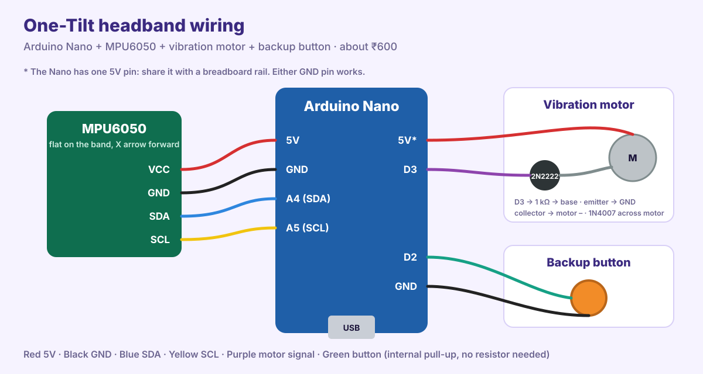

# Building the headband

Total cost: **about ₹600** in parts. No soldering is needed for a first version; jumper wires are enough.

## Parts

| Part | Why | Approx. price |
| --- | --- | --- |
| Arduino Nano (CH340 USB) | Reads the sensor, detects gestures, talks USB | ₹250 |
| MPU6050 module (GY-521) | 3-axis accelerometer + gyroscope for head angles | ₹120 |
| Coin vibration motor (3 V) | Buzz so the user *feels* each pick | ₹40 |
| 2N2222 transistor, 1N4007 diode, 1 kΩ resistor | Drive the motor safely from a pin | ₹10 |
| Large push / arcade button | Backup "one switch" mode (hand, foot, chin) | ₹60 |
| Elastic headband + velcro | Holds the sensor on the head | ₹80 |
| Jumper wires, USB cable | Connections, power and data | ₹40 |

Prices are typical Indian retail (Robu, Amazon, local electronics markets) and vary.

## Wiring



```
MPU6050 (GY-521)        Arduino Nano
  VCC  ───────────────── 5V
  GND  ───────────────── GND
  SDA  ───────────────── A4
  SCL  ───────────────── A5

Vibration motor
  Nano D3 ── 1 kΩ ── 2N2222 base
  2N2222 emitter ─────── GND
  2N2222 collector ───── motor (–)
  motor (+) ──────────── 5V
  1N4007 across the motor, stripe towards 5V (protects the transistor)

Backup button
  Nano D2 ── button ── GND        (uses the Nano's internal pull-up)
```

## Mounting

Put the MPU6050 **flat on top of the band**, chip side up, with the printed **X arrow pointing forward** (towards the face). The Nano can sit at the back of the band or on the user's shoulder/chair with a longer cable.

Mounted another way? Open the One-Tilt side panel → *Sensitivity & mounting* and tick *Sensor turned 90°*, *Flip left/right* or *Flip up/down* until the live dot moves the same way as the head. The setting is saved on the Nano.

## Flashing

1. Install the Arduino IDE (2.x). No extra libraries are needed (only `Wire` and `EEPROM`, which come with it).
2. Open `firmware/one_tilt_headband/one_tilt_headband.ino`.
3. *Tools → Board → Arduino Nano*. For most clones also pick *Processor → ATmega328P (Old Bootloader)*.
4. Upload. Open the Serial Monitor at **115200** baud: you should see `HELLO OneTilt 1.0` and `OK calibrated`.
5. Tilt your head: the monitor prints `LEFT`, `RIGHT`, `NOD`, `UP` and (after 3 s looking up) `HELP`.

## Gestures

| Head movement | Event | What happens |
| --- | --- | --- |
| Tilt right / left (held ~0.1 s) | `RIGHT` / `LEFT` | Move to the next / previous choice |
| Quick nod down and back | `NOD` | Choose the highlighted choice |
| Look up, then back | `UP` | Start listening for a voice command |
| Keep looking up for 3 s | `HELP` | Help alert countdown (any move cancels) |
| Button short press / long press | `RIGHT` / `NOD` | One-switch mode |

Each gesture must return to the resting position before the next one counts, so a slumped or shaking head doesn't fire repeated actions. Thresholds start at 18° (tilt), 12° (nod) and 15° (look up) and can be lowered for people with very small movement.

## Serial protocol

115200 baud, one text line per message.

| Direction | Message | Meaning |
| --- | --- | --- |
| Headband → browser | `LEFT`, `RIGHT`, `NOD`, `UP`, `HELP` (+ ` BTN` from the button) | Gestures |
| Headband → browser | `A,<roll>,<pitch>` | Live angles (when streaming is on) |
| Browser → headband | `C` | Calibrate the resting pose |
| Browser → headband | `B1` / `B2` / `B3` | Buzz: tick / double / long |
| Browser → headband | `V1` / `V0` | Live angle stream on / off |
| Browser → headband | `S,<tilt>,<nod>,<look>` | Thresholds in degrees |
| Browser → headband | `O,<swap>,<flipRoll>,<flipPitch>` | Mounting fixes (0/1) |
| Browser → headband | `P`, `?` | Ping, print settings |
